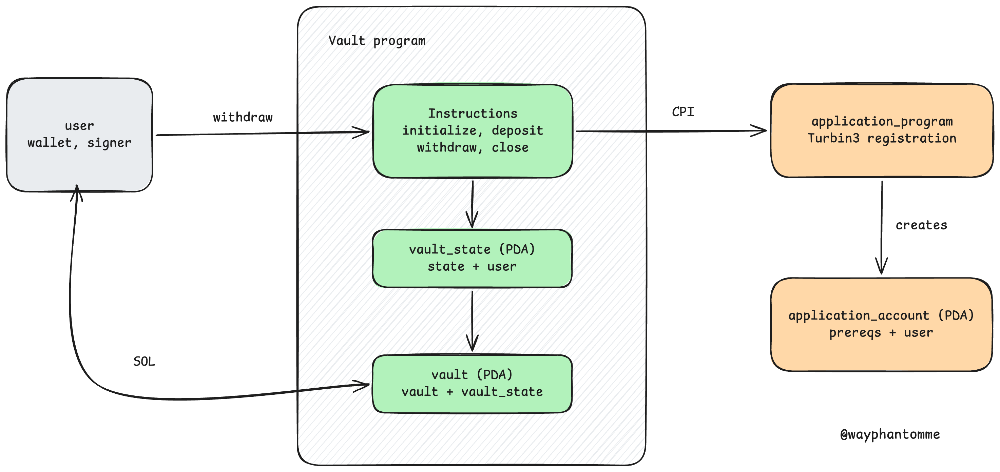

# Turbin3 Q4 2026 Prerequisite: Vault + CPI

Anchor Vault program (`pre-req-vault`) that extends `withdraw` with a CPI
to the Turbin3 registration program, recording my GitHub username on-chain.

## Architecture



## Links

- Video walkthrough: <link YouTube>
- Capstone Pre-Work: https://docs.google.com/document/d/1RP-8rVynOG_yNcjZE8FKjUqXLpr5Jgh_9LnAY8QvUeU/edit?usp=sharing

## How it works

- `initialize` creates `vault_state` and derives the `vault` PDA
- `deposit` / `withdraw` move SOL between user and vault
- `withdraw` also calls `application_program` via CPI, which creates
  `application_account` with my GitHub username
- `close` returns all SOL and closes `vault_state`

## Proof (devnet)

- Program ID: `6hsVzqmXxX6CBaD1boxSVTR3KMbb1152Zq4ytsfpqU9Q`
- Withdraw tx: https://explorer.solana.com/tx/2mzkbT8ovxuwjLUy6SpKDPJCLKMGombR2YifF4CLK8W8jkFjWbXtuPZ6qqZz7BGXQmxvqbWSnKBPfwker5H6gbBN?cluster=devnet

## Run

```bash
pnpm install
cargo build-sbf --arch v0      # build program
anchor idl build               # generate IDL + types
anchor deploy                  # deploy ke devnet
anchor test --skip-build --skip-deploy
```

Note: `anchor build` fails with platform tools v1.52 vs SBPFv3, so the
program is built with `cargo build-sbf --arch v0` and the IDL with
`anchor idl build`. A fresh clone also needs `anchor keys sync` first to
generate its own program ID. Each wallet can register only once, so a
second `anchor test` with the same wallet will fail at `withdraw`.
